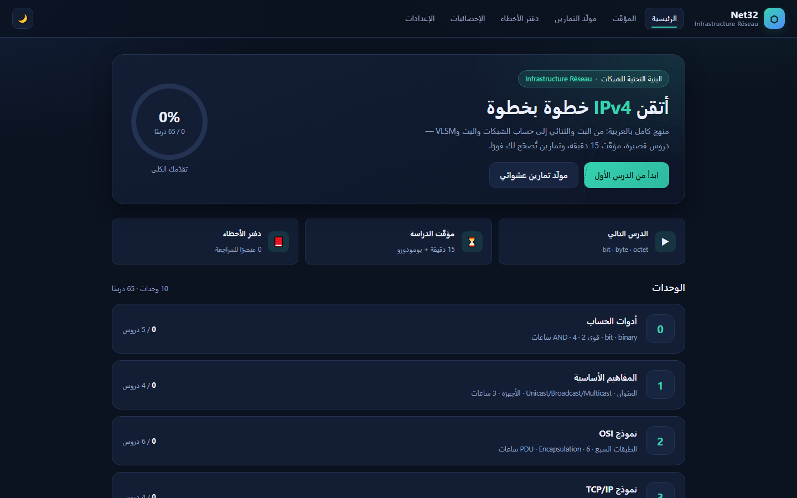
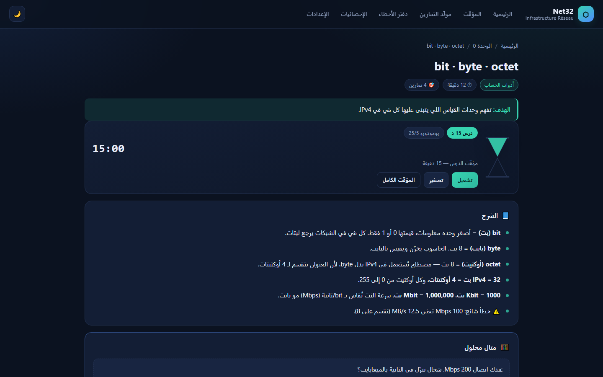
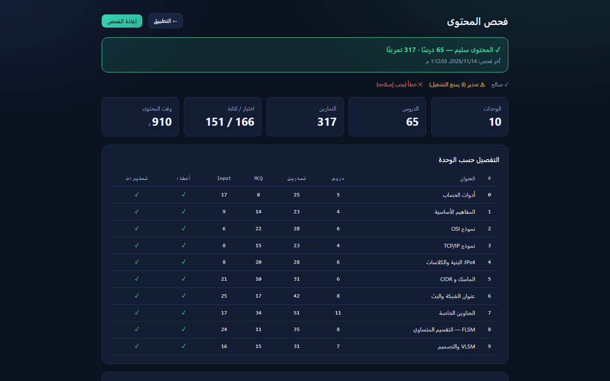

<div align="center">


# Net32 — أكاديمية IPv4

**البنية التحتية للشبكات · Infrastructure Réseau**

منصة تعليمية عربية تفاعلية لتعلّم عنونة **IPv4** من البت والثنائي إلى التقسيم وVLSM — تعمل بلا إنترنت وبلا تثبيت.

[](https://louai-devsecops.github.io/net32/)
[](https://louai-devsecops.github.io/net32/validate.html)




</div>

---

## ✨ نظرة سريعة

**Net32** منصة تعليمية عربية تفاعلية لتعلّم **عنونة IPv4** من الصفر: من البت والثنائي، إلى الماسك وCIDR، وحساب عناوين الشبكة والبث، ثم FLSM وVLSM. تعمل بالكامل في المتصفح، بلا إنترنت، بلا حساب، وبلا أي تبعيات.

- 📚 **10 وحدات** متسلسلة · **65 درسًا** · **317 تمرينًا**
- 🎯 **بوابة إتقان 80%** لكل درس
- ⏱️ **مؤقّت دراسة** 15 دقيقة + وضع بومودورو (25/5)
- 🧠 **مولّد تمارين** عشوائي مع شرح الخطوات
- 📓 **دفتر أخطاء** تلقائي ومراجعة مركّزة
- 📊 **إحصائيات** وتصدير/استيراد التقدّم
- 📴 **يعمل بلا إنترنت** — كل شيء محلي في المتصفح
- ✅ **فحص محتوى مدمج** (`validate.html`) — 0 أخطاء و0 تحذيرات

## 🗺️ المنهج

| # | الوحدة | الدروس | التمارين |
|:---:|---|---:|---:|
| 0 | أدوات الحساب | 5 | 25 |
| 1 | المفاهيم الأساسية | 4 | 23 |
| 2 | نموذج OSI | 6 | 28 |
| 3 | نموذج TCP/IP | 4 | 23 |
| 4 | IPv4: البنية والكلاسات | 6 | 28 |
| 5 | الماسك و CIDR | 6 | 31 |
| 6 | عنوان الشبكة والبث | 8 | 42 |
| 7 | العناوين الخاصة | 11 | 51 |
| 8 | FLSM — التقسيم المتساوي | 8 | 35 |
| 9 | VLSM والتصميم | 7 | 31 |
| **المجموع** | **10 وحدات** | **65** | **317** |

## 📸 لقطات من المنصة

<table>
  <tr>
    <td align="center" width="50%">
      <br>
      <sub>شرح ومثال محلول ومؤقّت لكل درس</sub>
    </td>
    <td align="center" width="50%">
      <br>
      <sub>فحص آلي: 0 أخطاء و0 تحذيرات</sub>
    </td>
  </tr>
</table>

## 🚀 التشغيل

### مباشرة من المتصفح

1. استنسخ المستودع:
   ```bash
   git clone https://github.com/louai-devsecops/net32.git
   cd net32
   ```
2. افتح `index.html` في المتصفح.

لا حاجة إلى `npm install` أو build أو سيرفر.

### الرابط المنشور

- **المنصة:** <https://louai-devsecops.github.io/net32/>
- **فحص المحتوى:** <https://louai-devsecops.github.io/net32/validate.html>

## ✅ فحص المحتوى

افتح `validate.html` لفحص كل الدروس والتمارين آليًا:

> **النتيجة:** 65 درسًا · 317 تمرينًا · **0 أخطاء** · **0 تحذير**

الفحص يتحقق من البنية، الإجابات، التكرار، وتوازن أنواع التمارين.

## 🧱 بنية المشروع

```text
net32/
├── index.html              # هيكل الصفحة وتحميل الوحدات
├── styles.css              # التنسيق RTL + الوضع الداكن/الفاتح
├── app.js                  # التوجيه، المؤقّت، التمارين، المولّد، الإحصائيات
├── branding.js             # البصمة: المادة، الاسم، المعهد، السنة، الشعار
├── favicon.svg
├── validate.html           # واجهة فحص المحتوى
├── validate.js             # مدقّق المخطط
├── content/                # unit0.js … unit9.js
├── assets/
│   ├── logo.jpg
│   ├── logo-round.png
│   └── social-preview.png
├── docs/screenshots/       # صور README
├── LICENSE                 # MIT (الكود)
├── CONTENT-LICENSE.md      # CC BY-SA 4.0 (المحتوى)
└── .nojekyll
```

## 🛠️ التقنيات

| المكوّن | التفاصيل |
|---|---|
| الواجهة | HTML5 · CSS3 · JavaScript (Vanilla) |
| التخزين | `localStorage` — بلا حسابات أو سيرفر |
| التوجيه | Hash routing (`#/lesson/0.1`) — يعمل على GitHub Pages وأي مجلد فرعي |
| الاستضافة | GitHub Pages |
| التبعيات | **صفر** — لا Node، لا npm، لا build |
| الخصوصية | بلا تتبّع، بلا كوكيز، بلا إرسال بيانات |

## 📄 الترخيص

- **الكود:** [MIT](LICENSE)
- **المحتوى التعليمي:** [CC BY-SA 4.0](CONTENT-LICENSE.md)

يمكنك استخدام الكود وتعديله مع الإبقاء على إشعار الحقوق. المحتوى التعليمي يمكن مشاركته وتعديله بشرط نسبه إلى المؤلف والمشاركة بنفس الترخيص.

## 👤 المؤلف

**لؤي مهدي — Louai Mahdi**  
مركز الامتياز للاقتصاد الرقمي — سيدي عبد الله  
*Center of Excellence in Digital Economy — Sidi Abdellah*  
**2026 / 2027**

## 🤝 المساهمة

الاقتراحات والأخطاء عبر [Issues](https://github.com/louai-devsecops/net32/issues).

---

## English

**Net32** is an Arabic-first, interactive IPv4 learning platform: 10 units, 65 lessons, and 317 exercises covering binary math, subnet masks, CIDR, network/broadcast addresses, FLSM, and VLSM. It is a 100% static, offline-first web app with zero dependencies — open `index.html` and start learning.

- **Live demo:** <https://louai-devsecops.github.io/net32/>
- **Content validation:** <https://louai-devsecops.github.io/net32/validate.html>
- **Stack:** HTML · CSS · Vanilla JavaScript · GitHub Pages
- **License:** MIT (code) · CC BY-SA 4.0 (content)

<div align="center"><sub>صُنع بـ ❤️ لتعليم الشبكات بالعربية · Net32 © 2026</sub></div>
